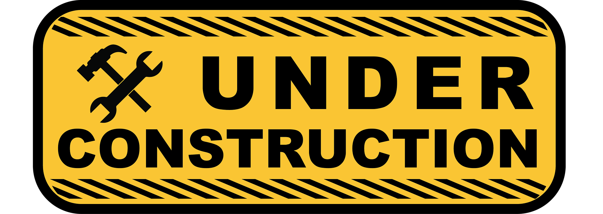

+++
title = "A blog? In *this* economy?"
date = 2026-10-14
description = "my first post"
updated = 2026-10-15
[extra]
status = "draft"
+++

For quite a while I've had some ideas for things I wanted to write about, but I
didn't have a forum where I wanted to share them. Substack is popular, but I
have some ethical concerns with them.[^1] Also, the things I want to write
about don't really fit into a particular category - some are about software
engineering, some about service operations, some about organizations. So
considering one of my primary motivations is getting a job, a lot of my thoughts
aren't really relevant to put on LinkedIn (and besides, I don't want to feel
locked into their platform).

A little while back I was hanging out with my friend Regina and she mentioned
that she's been writing a blog since the early aughts
([reginachicana.com](https://reginachicana.com)). I started to read it and it's
really good! She talks about all sorts of things, writes well, and has
interesting thoughts. It reminded me that I used to read a number of blogs
regularly and I wondered why I got out of the habit. It also made me think I
should actually start putting my thoughts down and putting them out there, not
because I think I can write as well as Regina or that my thoughts are as
interesting (I can guarantee they're not). But because it made me realize I
don't have to stick to a specific theme[^2], that old-school blogs still exist,
and that you don't have to have a massive following to enlighten or inspire
others.

Remember when every other web page had an under construction banner? Pepperidge
Farm Remembers. Anyway, I was listening to an interview with Maggie Appleton on
*The Pragmatic Engineer Podcast* and she talked about a digital garden. "It's a
blog where every piece you put up does not have to be finished as long as you
clearly signal to the audience it's not . . . you can put a piece up that is
half done and then update it later." [^3] I'm going to try this approach and
hope that I'll find it liberating. I don't think I'm a perfectionist, but it
should make it easier to get started if I don't have to feel like things are
finished in order to publish them. And perhaps having some half-baked ideas out
there in public will be the prod I need to get them finished. ;-)

💡 = idea/stub
📝 = draft/in progress
📕 = done(ish)
📜 = maybe a little outdated

[^1]: Substack has (had?) a Nazi problem: [www.theguardian.com/media/2026/feb/07/revealed-how-substack-makes-money-from-hosting-nazi-newsletters](https://www.theguardian.com/media/2026/feb/07/revealed-how-substack-makes-money-from-hosting-nazi-newsletters?isExternal=true), [www.engadget.com/apps/substack-accidentally-sent-push-alerts-promoting-a-nazi-publication-191004115.html](https://www.engadget.com/apps/substack-accidentally-sent-push-alerts-promoting-a-nazi-publication-191004115.html)
[^2]: *Chicana on the Edge*, "I Have No Niche": [reginachicana.com/2026/08/i-have-no-niche/](https://reginachicana.com/2026/08/i-have-no-niche/)
[^3]: Maggie Appleton on *The Pragmatic Engineer* podcast: [youtu.be/KZSzF0KEFRg?t=4457&si=rgZvvLh4ZGXYrI2O](https://youtu.be/KZSzF0KEFRg?t=4457&si=rgZvvLh4ZGXYrI2O)